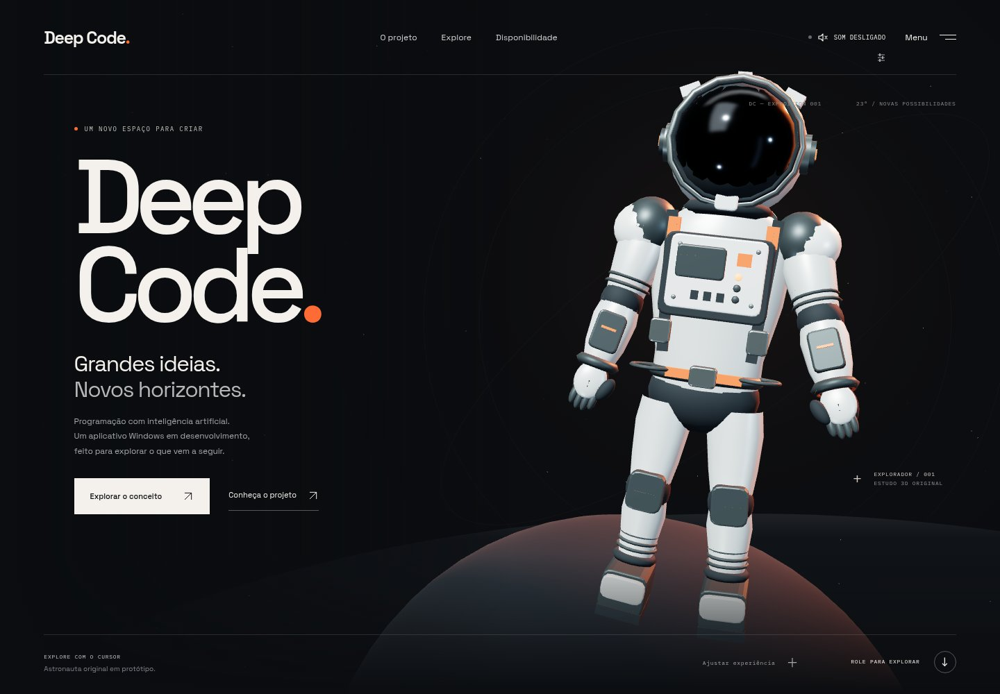

# Deep Code — website V1

Primeira implementação executável da experiência Deep Code, com React, TypeScript, Vite e Three.js. Inclui astronauta procedural original **em protótipo**, cena interativa, navegação, demonstração conceitual em HTML, áudio sintetizado opcional e conteúdo independente de WebGL.

A identidade tipográfica e a paleta são provisórias: a logo do aplicativo Windows não está disponível neste ambiente. Nenhuma funcionalidade específica do aplicativo, integração de IA, release ou executável é anunciada como verificada.



[Composição mobile](docs/previews/deep-code-mobile.jpg). Capturas da implementação própria, não da referência.

## Executar

Node testado: **24.22.1** (`.nvmrc`).

```sh
npm ci
npm run dev -- --host 127.0.0.1 --port 4173
```

Abrir `http://127.0.0.1:4173/` **na máquina em que o servidor está executando**. Vite atualiza a página automaticamente durante alterações. O localhost do Codex Cloud não é automaticamente o localhost do seu Windows; não foi criado túnel ou deploy público.

```sh
npm run typecheck
npm run lint
npm run test
npm run build
npm run preview -- --host 127.0.0.1 --port 4175
npm run test:e2e
```

O build pré-renderiza o conteúdo em HTML e gera uma pasta `dist/` estática. `preview` serve esse build localmente; não publica o site. Os testes usam Chromium do sistema quando disponível; em Windows/macOS procuram Chrome instalado. Para outro executável, configurar `CHROMIUM_PATH` na sessão. As validações desta entrega ocorreram em Linux/Chromium, não no Windows físico.

Para verificar fallback manualmente, abrir `/?graphics=off`. No rodapé do hero, “Ajustar experiência” permite selecionar qualidade, desligar 3D e pausar movimentos. O controle de som começa desligado e exige gesto; preferências não iniciam som automaticamente após recarga.

## O que existe

- Hero e astronauta original com visor, traje, painéis, mochila, articulações, luvas e botas; ambiente procedural, materiais/reflexos e iluminação própria.
- Câmera e personagem reagem ao ponteiro/scroll com amortecimento. Qualidade adaptativa e suspensão quando oculto, fora de tela, pausado ou com menu aberto.
- Seções: projeto, demonstração, possibilidades, IA, exploração, downloads, atualizações, FAQ e rodapé.
- Demonstração com três cenários, teclado e reinício; identificada como conceito, não como captura do aplicativo.
- Menu modal com foco/Escape, movimento reduzido, fallback gráfico e HTML pré-renderizado utilizável sem JavaScript.
- Downloads desabilitados até existir arquivo aprovado. Nenhum modelo/provedor, preço, versão ou data de lançamento inventado.

## Documentação da implementação

- [Arquitetura implementada](docs/ARQUITETURA_SITE.md)
- [Identidade e importação da logo oficial](docs/IDENTIDADE_VISUAL.md)
- [Experiência 3D](docs/EXPERIENCIA_3D.md)
- [Animações e interações](docs/ANIMACOES_INTERACOES.md)
- [Áudio](docs/AUDIO.md)
- [Performance e condições das medições](docs/PERFORMANCE.md)
- [Testes](docs/TESTES_VALIDACAO.md)
- [Pendências](docs/PENDENCIAS.md)
- [Relatório V1](docs/RELATORIO_DESENVOLVIMENTO_V1.md)

O histórico de pesquisa permanece intacto em [docs/site-reference/lusion](docs/site-reference/lusion/README.md). Ele continua registrando uma referência inacessível; não é evidência de equivalência visual desta implementação ao Lusion.

O protótipo não está aprovado para produção. A meta de 90–120 FPS depende de validação em hardware físico compatível; os testes em SwiftShader não comprovam essa meta.
